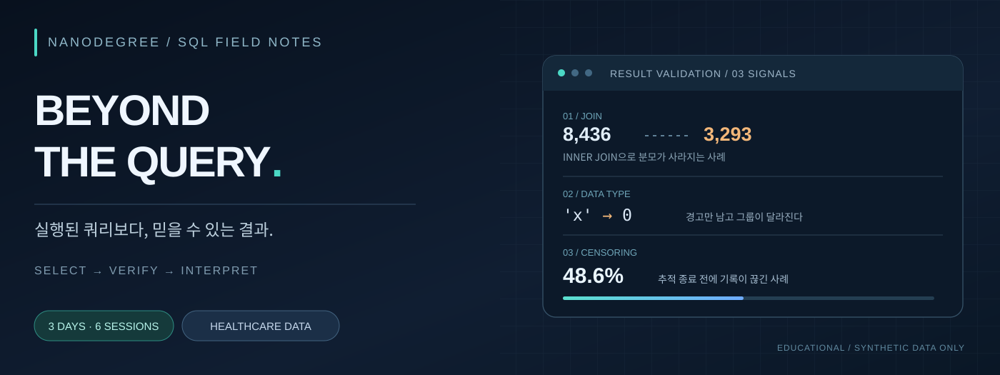
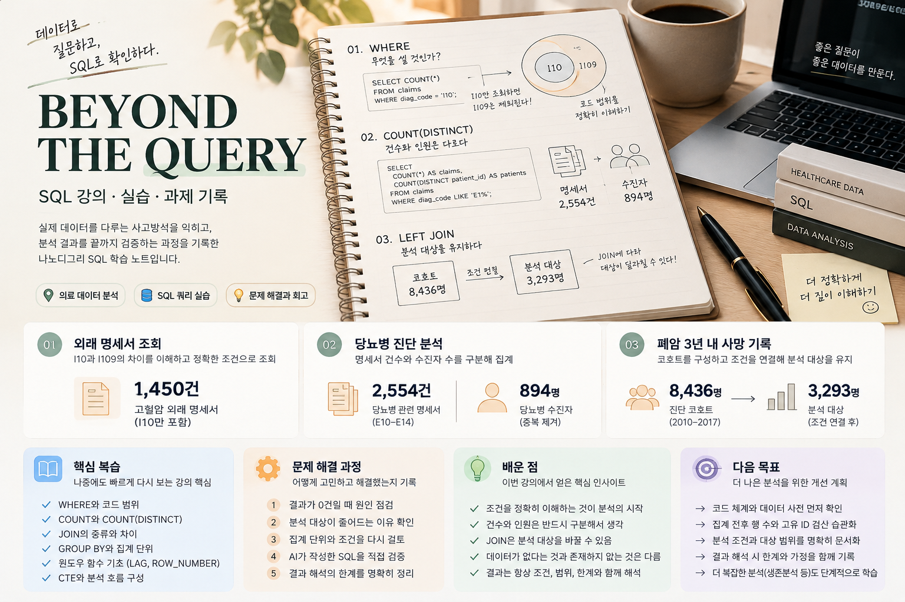

# BEYOND THE QUERY

**나노디그리 SQL 강의 · 실습 · 과제 기록**  
`MySQL` · `DBeaver` · `SELECT / JOIN` · `GROUP BY / 윈도우 함수` · `CTE / 코호트`

> SQL이 실행됐다는 사실보다 **어떤 조건으로, 무엇을 세고, 누구를 분석에 남겼는지** 설명하는 연습을 기록했다.

[🧠 핵심 복습](#5분-핵심-복습) · [강의·실습](#3-주요-실습-내용) · [SQL 예시](#4-주요-sql과-설명) · [문제 해결](#5-문제-해결-과정) · [배운 점](#7-배운-점)

---

### 5분 핵심 복습

나중에 다시 공부할 때는 **아래 질문을 스스로 답해 보고**, 막히는 부분만 상세 노트로 돌아가면 된다.

| 스스로 확인할 질문 | 떠올릴 SQL·개념 | 더 읽기 |
|:--|:--|:--|
| 원하는 행을 정확히 골랐나? | `WHERE` · 날짜·코드값 · `ORDER BY` | [조회·JOIN 노트](field-notes/day-01.md) |
| 명세서 건수와 환자 수를 구별했나? | `COUNT(*)` vs `COUNT(DISTINCT)` · `GROUP BY` | [집계·윈도우 노트](field-notes/day-02.md) |
| 방문 순서와 직전 기록을 구할 수 있나? | `ROW_NUMBER` · `LAG` · `OVER` · `WITH` | [집계·윈도우 노트](field-notes/day-02.md) |
| JOIN 후 분석 대상이 달라졌나? | `INNER/LEFT JOIN` · `CASE` · `NULL` | [코호트 노트](field-notes/day-03.md) |

**[📖 개념별 핵심 복습 보기](review/quick-review.md) · [✍️ 정답 가리고 10문제 풀기](review/self-check.md) · [📚 전체 강의 원본 정리](deep-notes/day-01-full.md)**

---

## 1. 프로젝트 소개

나노디그리 SQL 강의에서 익힌 개념을 의료 청구 형식의 교육용 데이터에 적용해 보고, **실습 쿼리·과제 집계·문제 해결·학습 회고**를 연결해 정리한 저장소다.

특히 세 가지 질문을 중심으로 공부했다.

| 핵심 질문 | 관련 SQL | 실제 실습에서 확인한 점 |
|:--|:--|:--|
| **조회 조건이 맞는가?** | `WHERE`, `JOIN` | `I10`으로 조회한 0건이 코드 저장 방식(`I109`) 때문일 수 있었다. |
| **무엇을 한 건으로 세는가?** | `GROUP BY`, `COUNT(DISTINCT)`, `LAG` | J209 **2,554건**과 고유 수진자 **894명**은 서로 다른 지표다. |
| **누가 분석에 남는가?** | `WITH`, `LEFT JOIN`, `CASE` | 사망 기록이 없는 사람을 조인에서 제외하면 분석 대상 자체가 달라진다. |

**데이터 안내:** 강의 자료는 교육용 가상·합성데이터다. 실제 환자의 의료 결과로 해석하지 않으며, 원본 환자 단위 데이터와 접속정보는 공개하지 않는다.

## 2. 사용 기술

| 도구 / 개념 | 활용 내용 |
|:--|:--|
| **MySQL / DBeaver** | SQL 실행, 데이터 확인, 결과 검토 |
| `SELECT` · `WHERE` · `ORDER BY` | 기간·조건 검색과 정렬 |
| `JOIN` · `LEFT JOIN` | 명세서·상병 마스터·사망 기록 연결 |
| `GROUP BY` · `HAVING` | 상병별·기관 종별 집계 및 그룹 조건 |
| `ROW_NUMBER` · `LAG` · `OVER` | 환자별 방문 순번·간격·누적값 |
| `WITH`(CTE) · `CASE WHEN` | 연구 코호트·병기 구분·조건부 집계 |
| Markdown · SVG | 재현 가능한 학습 기록과 결과 시각화 |

**핵심 학습 관점:** 데이터 한 행의 의미를 확인하고, `JOIN` 전후 행 수와 비율의 분자·분모를 검산하는 습관.

## 3. 주요 실습 내용

| 강의 주제 | 복습할 내용 | 기록 |
|:--|:--|:--|
| **조회 · 테이블 연결** | SELECT, WHERE, 정렬, JOIN과 코드 확인 | [핵심 노트](field-notes/day-01.md) · [상세 강의 정리](deep-notes/day-01-full.md) |
| **집계 · 방문 이력** | GROUP BY, HAVING, 윈도우 함수와 환자별 방문 간격 | [핵심 노트](field-notes/day-02.md) · [상세 강의 정리](deep-notes/day-02-full.md) |
| **코호트 · 사건 분석** | CTE, CASE, LEFT JOIN, NULL과 분석 대상 정의 | [핵심 노트](field-notes/day-03.md) · [상세 강의 정리](deep-notes/day-03-full.md) |

강의 노트는 개념부터 예시까지 남겨 두었고, 과제 기록과 SQL 코드는 별도 폴더에 정리했다.

| 과제 | 분석 질문 | 확인한 집계 | 과제·코드 |
|:--|:--|:--|:--|
| **01** | 기간과 조건에 맞는 외래 명세서 수는? | **1,450건** | [기록](assignments/assignment-01.md) · [SQL](sql/assignments/01_outpatient_claims.sql) |
| **02** | 질병별 명세서와 사람 수, 방문 간격은? | J209 **2,554건 / 894명** | [기록](assignments/assignment-02.md) · [SQL](sql/assignments/02_diagnosis_diabetes.sql) |
| **03** | 진단 코호트에서 병기별 사건 기록은? | **6,873명** 코호트 | [기록](assignments/assignment-03.md) · [SQL](sql/assignments/03_lung_cancer_3year_mortality.sql) |

[과제 전체 기록](assignments/README.md) · [SQL 실습 코드](sql/practice/)

### SQL 강의 한눈에 보기


## 4. 주요 SQL과 설명

### 4-1. 기간·서식 조건으로 정확한 기록 고르기

```sql
SELECT COUNT(*) AS outpatient_claims
FROM kr_claims.claim
WHERE recu_fr_dd >= '2025-07-01'
  AND recu_fr_dd <  '2025-08-01'
  AND fom_tp_cd = '031';
```

**과제 기록 기준:** 1,450건. `WHERE`가 조회 대상을 정의하고, `COUNT(*)`가 명세서 건수를 센다. 위 SQL은 동일 조건으로 다시 정리한 **재구성 코드**이며 제출 당시의 원문을 그대로 복사한 것은 아니다.

### 4-2. 환자별 방문 간격 계산하기

```sql
WITH visits AS (
    SELECT jid, recu_fr_dd,
           LAG(recu_fr_dd) OVER (
               PARTITION BY jid ORDER BY recu_fr_dd
           ) AS previous_visit
    FROM kr_claims.claim
    WHERE main_sick = 'E119'
)
SELECT jid, recu_fr_dd,
       DATEDIFF(recu_fr_dd, previous_visit) AS gap_days
FROM visits
WHERE previous_visit IS NOT NULL;
```

`LAG`로 같은 환자의 직전 방문일을 불러온다. 윈도우 함수를 `WHERE`에서 바로 거를 수 없으므로 CTE에서 먼저 계산한 뒤 바깥에서 조회한다. **과제 2 전체 조건이 복원되지 않아, 이 예시는 학습용 패턴으로, 과제의 전체 조건이 같지는 않을 수 있다.**

### 4-3. 코호트를 고정하고 사건 없는 대상도 보존하기

```sql
WITH cohort AS (
    SELECT pt_sbst_no, bspt_frst_diag_ymd
    FROM kr_lung_cancer.lung_pt_bsnf
    WHERE bspt_frst_diag_ymd >= '2010-01-01'
      AND bspt_frst_diag_ymd < '2018-01-01'
)
SELECT COUNT(*) AS cohort_size
FROM cohort;
```

2010~2017년 최초 진단 환자 6,873명이 과제 3의 기본 대상이다. 이후 사망 테이블은 `LEFT JOIN`으로 연결해 사망 기록이 없다는 이유만으로 대상자를 분모에서 제거하지 않도록 한다. 병기별 전체 재구성 코드는 [코호트 분석 SQL](sql/assignments/03_lung_cancer_3year_mortality.sql)에 포함했다.

> **코드 안내:** 과제 SQL 파일은 제출 원문을 복제한 것이 아니라 **복습용으로 다시 작성한 예시**다. 결과 집계와 코드 예시의 조건이 완전히 같다고 보장할 수 없으므로 [실행 환경과 검증 안내](docs/verification.md)를 참고한다.

## 5. 문제 해결 과정

강의에서 특히 중요했던 건 **SQL이 오류 없이 실행되어도 분석 결론이 틀릴 수 있다**는 점이었다. 아래는 실제 실습에서 다룬 문제를 다음 작업에 적용할 행동으로 바꾼 기록이다.

| 상황 | 왜 그대로 믿으면 안 됐나 | 내가 다음에 할 검증 |
|:--|:--|:--|
| `I10` 조회가 0건 | 코드가 더 구체적인 `I109`로 저장되어 있을 수 있다. | 먼저 `DISTINCT`와 코드표로 실제 저장값 확인 |
| J209 명세서 2,554건 | **2,554명**이라는 뜻이 아니다. 고유 수진자는 **894명**이다. | `COUNT(*)`와 `COUNT(DISTINCT)` 나란히 계산 |
| `GROUP BY` 오류 1055 | 그룹 기준에 없는 원본 열을 집계 없이 출력하려 했다. | 먼저 **그룹당 1행**인지 **원래 행 유지**인지 결정 |
| `LAG()` 필터에서 오류 3593 | 윈도우 계산을 `WHERE`보다 먼저 참조하려 했다. | `WITH`로 계산 단계와 필터 단계를 분리 |
| 사망 기록을 `INNER JOIN` | 사건이 없는 환자가 분석 대상에서 제외될 수 있다. | 코호트를 먼저 고정하고 JOIN 전후 고유 ID를 검산 |
| 병기값 `'x'`를 숫자로 비교 | 문자형 데이터가 묵시적으로 변환되어 분류가 뒤틀릴 수 있다. | 자료형과 고유값을 확인하고 문자로 비교 |

**가장 크게 남은 교훈:** 오류 메시지가 떠서 실패한 쿼리는 고칠 수 있다. 오히려 **실행은 성공했는데 분모가 바뀐 쿼리**를 발견하는 습관이 더 중요하다.

[오류별 원인·수정 노트](case-studies/failure-atlas.md) · [복습 문제로 다시 확인](review/self-check.md)

## 6. 실행 결과

### 6-1. 확인된 과제 집계

| 결과 | 확인 수치 | 해석 |
|:--|--:|:--|
| 2025년 7월 외래 명세서 | **1,450건** | 과제 1 Q1 집계 |
| J209 명세서 | **2,554건** | 과제 2의 당시 질문 조건에 따른 수치. 전체 기간 통계로 단정하지 않음 |
| J209 수진자 | **894명** | 명세서 건수와 구분해야 할 고유 인원 |
| 당뇨 방문 간격 90일 초과 | **1건, 94일** | 과제 2에서 확인된 결과. 전체 필터 조건 미복원 |
| 2010–2017 진단 코호트 | **6,873명** | 과제 3 Q1 |

### 6-2. 과제 3 — 병기별 1,095일 이내 사망 기록 집계

| 병기 그룹 | 환자 수 | 1,095일 이내 사망 기록 | 기록 비율 |
|:--|--:|--:|--:|
| 초기 (0·1·2) | 2,666 | 347 | **13.02%** |
| 국소 진행 (3) | 1,098 | 535 | **48.72%** |
| 전이 (4) | 2,879 | 1,838 | **63.84%** |
| 병기 미상 | 230 | 109 | **47.39%** |
| **합계** | **6,873** | **2,829** | **41.16%** |

**결과 해석:** 교육용 가상데이터에서 과제 조건에 따라 집계한 **사망 기록 비율**이다. 사망 기록이 없는 환자가 3년 내내 관찰되었다고 확인된 것은 아니므로, 이 표를 실제 환자의 생존율로 읽을 수는 없다.

[결과 집계와 한계 상세](sql/results/README.md) · [과제 3 기록](assignments/assignment-03.md)

## 7. 배운 점

### ① SQL을 잘한다는 건 숫자뿐 아니라 **조건을 설명하는 것**

처음에는 `SELECT`가 원하는 결과를 보여 주는지가 중요하게 느껴졌지만, `I10`과 `I109` 사례처럼 **조건의 실제 값이 틀리면 문법이 맞아도 잘못된 답**을 얻게 된다는 점이 기억에 남았다. 앞으로는 실행 전에 **기록 한 행의 의미, 기간, 코드, 제외 조건**부터 적는 연습을 하려고 한다.

### ② 같은 데이터라도 **무엇을 세는지**가 달라지면 다른 이야기가 된다

J209의 **2,554건 / 894명**은 이를 가장 쉽게 보여 준다. `GROUP BY`와 윈도우 함수의 차이도 단순 문법 차이가 아니라, **요약해서 한 행으로 만들지, 개별 기록을 유지할지**의 선택이다. 다음에는 지표에 건·명·일 단위를 꼭 붙이고, `COUNT(*)`와 고유 ID 개수를 함께 확인하겠다.

### ③ `JOIN`을 배운 뒤에는 **사라진 행**이 더 궁금해졌다

사망 정보와 `INNER JOIN`하면 사망 기록이 없는 대상이 빠질 수 있다. 숫자가 달라졌을 때 SQL 문법만 고치는 대신 **누가 결과에서 빠지거나 중복됐는지**를 찾아야 한다는 점을 배웠다. 다음에는 CTE로 대상자 목록을 고정하고 연결 전후 행 수와 고유 인원을 비교하겠다.

### ④ 결과를 말할 때는 **데이터가 알려 주지 않는 것**도 구분해야 한다

사망 기록이 없는 사람을 곧바로 3년 생존자로 보거나, 교육용 가상데이터의 비율을 실제 환자의 지표처럼 소개하면 안 된다. **기록이 없는 상태**와 **사건이 없음을 확인한 상태**는 다를 수 있다. 이후 분석에서는 관찰 기간과 결과의 한계를 먼저 정리하겠다.

### ⑤ AI가 초안을 만들어도 **내가 설명할 수 있어야 내 SQL**이다

AI를 활용해 작성 속도를 높이는 것만으로는 부족하다. 조건·조인 키·집계 단위·결측값을 직접 이해하고 검증하는 연습이 필요하다. 다음에는 쿼리 초안을 받은 뒤 요구사항과 한 줄씩 대조하고, **왜 그 결과가 나왔는지 스스로 설명할 수 있는지** 확인하려고 한다.

### 다음 SQL 실습에 적용할 개선 루틴

| 순서 | 앞으로 할 일 | 완료 판단 기준 |
|:--|:--|:--|
| **1 · 문제 정의** | 분석 대상·기간·지표를 한 문장으로 기록 | 질문과 `WHERE` 조건이 일치 |
| **2 · 기준 확인** | 한 행의 의미와 코드값·NULL 상태 살피기 | 건수와 인원을 구분할 수 있음 |
| **3 · 조인 검증** | 연결 전후 행 수·고유 ID 비교 | 빠지거나 늘어난 행을 설명할 수 있음 |
| **4 · 결과 해석** | 분모·분자·단위·관찰 범위 명시 | 결과를 다른 사람이 오해하지 않음 |
| **5 · 기록 보관** | 문제·최종 SQL·실행 결과·수정 이유 저장 | 다음에 같은 조건으로 재검토할 수 있음 |

**[느낀 점·개선 계획 전체](docs/reflection.md)** · [핵심 복습으로 돌아가기](review/quick-review.md)

## 8. GitHub 링크 및 결과물 경로

| 확인할 자료 | 저장소 내 경로 |
|:--|:--|
| 메인 소개 | **현재 README** (`README.md`) |
| 강의 핵심 노트 | [`field-notes/`](field-notes/) |
| **5분 핵심 복습·자가 점검** | [개념 복습](review/quick-review.md) · [셀프 체크](review/self-check.md) |
| 상세 강의 노트 | [`deep-notes/`](deep-notes/) |
| 과제 1·2·3 정리 | [`assignments/`](assignments/) |
| 과제별 SQL 재구성 | [`sql/assignments/`](sql/assignments/) |
| 학습용 실습 SQL | [`sql/practice/`](sql/practice/) |
| 집계 결과와 CSV | [`sql/results/`](sql/results/) |
| 오류·문제 해결 사례 | [`case-studies/`](case-studies/) |
| 실행 및 검증 안내 | [`docs/verification.md`](docs/verification.md) |

**GitHub 저장소:** [Justman-yzz/nanodegree-sql](https://github.com/Justman-yzz/nanodegree-sql)

---

<div align="center">

**BEYOND THE QUERY** · SQL 강의·실습 기록

</div>
