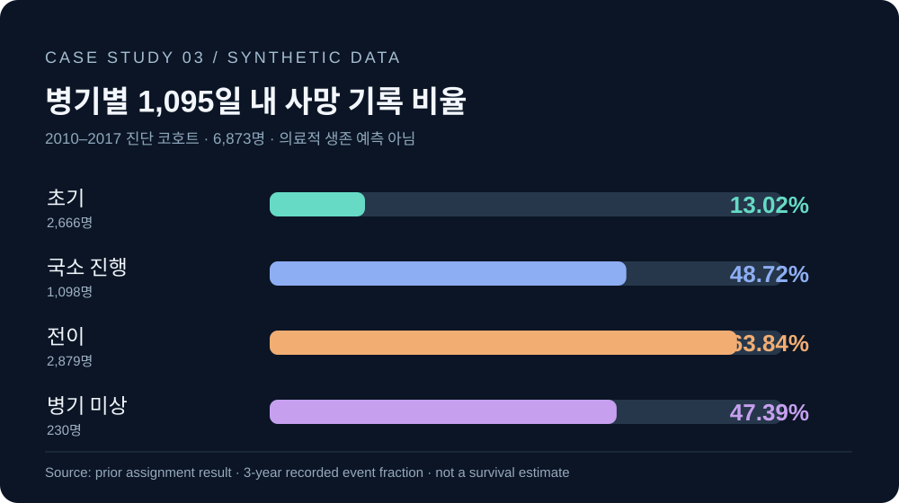

# RESULTS / 과제에서 확인한 분석 결과

> 아래 수치는 **2026년 10월 당시 과제 대화 및 개념 정리에서 확인한 교육용 데이터의 집계 결과**다. 이번 저장소 제작 작업에서 교육용 MySQL 데이터베이스를 다시 실행하지 않았다.

## 과제별 확인 결과

| 과제 | 확인된 결과 | 범위·주의 |
|:--|:--|:--|
| 01 | 2025년 7월 외래 명세서 1,450건 | 과제 Q1 |
| 02 | J209 2,554건, 894명, 2.86건/인 | 과제 당시의 필터 전체 미확보. 전체 기간 수치로 일반화 금지 |
| 02 | HAVING 조건 결과 7개 행 | 적용 당시 쿼리의 전체 조건 미확보 |
| 02 | 당뇨 방문 간격 90일 초과 1건(94일) | 당시 과제 조건의 일부 미복원 |
| 03 | 2010–2017 진단 코호트 6,873명 | 과제 Q1 |
| 03 | 병기별 사망 기록 비율 13.02 / 48.72 / 63.84 / 47.39% | 중도절단 미반영·합성데이터 |

[과제별 상세 설명](../../assignments/README.md) · [메인 README 결과](../../README.md#6-실행-결과)

## 병기별 결과 시각화

수치 원본은 [`assignment-03-stage-summary.csv`](assignment-03-stage-summary.csv)에 비식별 집계값만 수록했다.

## 해석 제한

- `kr_claims`의 청구/환자 기록은 가상 데이터다.
- 폐암 데이터는 합성데이터이므로 실제 환자의 생존율·치료성과를 의미하지 않는다.
- 사망 기록 유무를 그대로 1/0으로 세는 집계는 중도절단에 따른 편향이 생길 수 있다.
- 환자별 원본 기록과 교육용 데이터셋 전체를 저장소에 공개하지 않는다.
